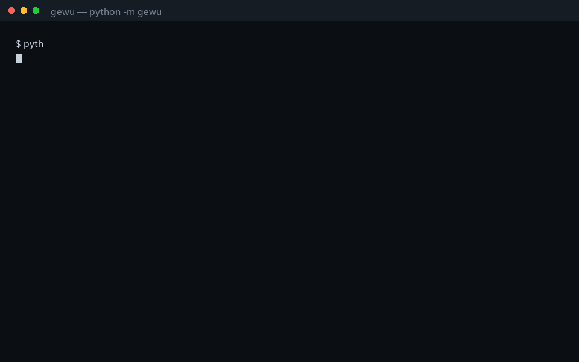

# 格物 GeWu · 多 Agent 深度研究助手

[](https://github.com/wushiyi105-jpg/gewu/actions)
[]()
[](./LICENSE)
[]()



> 输入一个课题,四个角色接力:规划者拆题、研究者求证、写作者成文、审稿者挑刺,最后交一份带真实来源的报告。

我做的前三个作品都是「一个 Agent + 工具调用 / 视觉」。这一个换了个问题:**当一件事需要四种彼此不信任的能力时,怎么让它们协作?**

格物的答案是分工 + 交接物 + 返工:规划者只拆题、研究者只对一个子问题负责、写作者只负责成文、审稿者的 KPI 是挑出毛病。每个角色的输出都是一份结构化的「交接物」,不合格就退回重写。

**CLI + Web 双入口,零第三方依赖,Py3.10+ 开箱即用。**

---

## 目录

- [它解决什么问题](#它解决什么问题)
- [四个角色](#四个角色)
- [编排流程](#编排流程)
- [三个我比较在意的设计](#三个我比较在意的设计)
- [快速开始](#快速开始)
- [命令参考](#命令参考)
- [一次 run 的产物](#一次-run-的产物)
- [断点续跑](#断点续跑)
- [联网检索是怎么做的](#联网检索是怎么做的)
- [Web 界面](#web-界面)
- [模型接入](#模型接入)
- [目录结构](#目录结构)
- [已知限制](#已知限制)
- [测试](#测试)
- [作者](#作者)

---

## 它解决什么问题

单 Agent 写长文有三个绕不开的毛病:

1. **一口气写完,没有中间检查点**——错在第三段,整篇都歪了,而且你不知道它歪在哪;
2. **自己夸自己**——同一个模型既写又审,审出来的永远是「结构清晰、论证充分」;
3. **来源靠编**——不检索就敢写「据某研究显示」,检索了也不一定标对。

格物的做法是把这三件事拆开:

- 拆题交给**规划者**,先把「一个太大的问题」切成四个能分别回答的问题;
- 求证交给**研究者**,一个子问题一次调用,检索结果贴着证据一起交上来;
- 成文交给**写作者**,它只能用手上的笔记,不能用别处来的印象;
- 挑刺交给**审稿者**,它拿不到「写作意图」,只看报告和来源编号能不能对上;
- 改稿再交回**写作者**,改完还要把「哪些地方证据不够」明写在正文里。

一句话:**不是让一个模型更努力,而是让四个角色互相限制。**

## 四个角色

| 角色 | 只做一件事 | 输入 | 交接物 |
|---|---|---|---|
| 🧭 规划者 Planner | 拆题 | 课题 + 子问题数量 | `Plan`:切分角度 + 每个子问题的查询词 |
| 🔍 研究者 Researcher | 求证(一个子问题一条独立任务) | 子问题 + 该子问题的检索材料 | `Note`:发现 + `[S#]` 引用 + 证据缺口 |
| ✍️ 写作者 Writer | 成文 | 全部笔记 | Markdown 初稿(摘要/分节/分歧/结论) |
| 🧐 审稿者 Critic | 挑刺 | 报告全文 + 可用来源编号 | `Critique`:high/medium/low 问题清单 + 遗漏 |
| ✍️ 写作者 Writer | 修订 | 初稿 + 审稿意见 | 终稿 |

角色之间不共享上下文,交接只有四种东西:`Plan` / `Note` / Markdown / `Critique`。这既是工程上的解耦,也是产品上的取舍——**能看见的交接物,才谈得上追责和返工。**

## 编排流程

```
课题
 │
 ├─① 🧭 规划者   → Plan(4 个子问题 + 查询词)
 │
 ├─② 🔍 研究者 Q1 → 检索 → Note#1   ┐
 ├─② 🔍 研究者 Q2 → 检索 → Note#2   │  每个子问题都是独立任务,
 ├─② 🔍 研究者 Q3 → 检索 → Note#3   │  单独落盘、单独可续跑
 ├─② 🔍 研究者 Q4 → 检索 → Note#4   ┘
 │
 ├─③ ✍️ 写作者   → 初稿(只能引用 Note 里的 [S#])
 │
 ├─④ 🧐 审稿者   → Critique(论据能不能回溯 / 因果有没有跳 / 漏了什么)
 │
 └─⑤ ✍️ 写作者   → 终稿(保留骨架,优先修 high/medium)
        │
        ├─ 系统统一追加「参考资料」(真实 URL,不让模型自己编)
        └─ 系统统一追加「协作任务看板」(每条任务的耗时与产物)
```

终端里长这样(这是真实运行时的一条):

```
🧭 规划者  拆解课题
   ├ Q1 …现状与关键事实是什么?
   ✓ 4 个子问题 · 10.3s
🔍 研究者  Q1 · …
   ├ 检索:大模型 就业 岗位
   ├ 命中:…
   ✓ 3 条发现 · 2 条有来源 · 41.2s
✍️ 写作者  整合成文 · 初稿
🧐 审稿者  挑刺:论据 / 逻辑 / 遗漏
   ✓ verdict=revise · 4 条意见(2 高)
✍️ 写作者  按审稿意见修订
```

## 三个我比较在意的设计

**① 来源清单由系统追加,不由模型生成。**
模型写「参考资料」时最爱编 URL。格物把所有检索结果在编排层编号(`S1`、`S2`…),写作者只能引用编号;终稿的「参考资料」一节由系统按编号重排,链接就是检索回来的那条。模型编不出来,因为它手里没有写链接的权限。

**② 模型知识必须自己承认。**
研究者拿到材料不够时,允许补常识,但那条发现要标 `model_knowledge`,并且正文里要写「(模型知识,未核验)」。搜不到材料时,报告不会假装有来源,而是明确写「本次未联网或检索无结果」。

**③ 审稿者拿不到「写作意图」。**
它只收到报告全文和「本次可用的来源编号」。这样它挑的是「这句有没有来源」,而不是「这句是不是我想说的」——自我审稿最容易糊弄的地方就在这里。

## 快速开始

```bash
git clone https://github.com/wushiyi105-jpg/gewu.git
cd gewu

cp .env.example .env        # 填入你自己的 LLM_API_KEY
python -m gewu "大模型会对就业产生什么影响"
```

没有 key 也能先把链路看一遍(模板内容,不联网,不花 token):

```bash
python -m gewu --mock --no-search "AI 会不会取代产品经理"
```

> 项目不自带任何 API key。`.env` 已 gitignore。

不想跑也能先看结果:[`data/demo-大模型与就业.md`](data/demo-大模型与就业.md) 是一次真实运行的终稿——4 个子问题、23 条来源、8 条协作任务,里面连「哪条结论只是模型知识」都标了出来。

## 命令参考

```bash
# 跑一次完整研究(默认入口)
python -m gewu "县域充电桩为什么建得慢"

# 参数
--depth 4            拆几个子问题(1~6,默认 4)
--no-search          不联网,只用模型知识(会更诚实,也更单薄)
--no-revise          跳过修订轮,只看初稿和审稿意见
--search-limit 4     每个查询词取几条结果
--out data/x.md      终稿另存一份
--json               输出结构化结果(任务、计划、审稿意见)
--quiet             只留结果
--mock              离线演示模式

# 只看规划者怎么拆题
python -m gewu plan "为什么小城市留不住年轻人"

# 历史与产物
python -m gewu runs
python -m gewu show 20261124-204500            # 打印终稿
python -m gewu show 20261124-204500 --tasks    # 打印任务看板

# 网页:左边看编排,右边看报告
python -m gewu web --port 8000
python -m gewu web --mock                      # 无 key 演示
```

## 一次 run 的产物

每次研究单独建目录,跑完可以整盘回看:

```
runs/20261124-204500/
├── meta.json                  # 课题 / 模型 / 参数 / 耗时 / 字数 / 来源数
├── tasks.json                 # 任务看板:每条任务的状态、耗时、产物
├── cache.json                 # 断点续跑缓存(按 角色+输入 哈希)
├── tasks/
│   ├── T1_planner.json/.md          # 拆题结果
│   ├── T2_researcher_Q1.json/.md    # 子问题 1 的发现与缺口
│   ├── T3_researcher_Q2.json/.md
│   ├── T6_writer.md                 # 初稿
│   ├── T7_critic.json/.md           # 审稿意见
│   └── T8_writer.md                 # 终稿
└── report.md                  # 完整报告(含参考资料与任务看板)
```

任务看板会原样写进报告末尾:

| 任务 | 角色 | 任务内容 | 状态 | 耗时 |
|---|---|---|---|---|
| T2 | 🔍 研究者 | Q1 · 现状与关键事实 | ✅ 完成 | 41.2s |
| T7 | 🧐 审稿者 | 挑刺:论据 / 逻辑 / 遗漏 | ✅ 完成 | 12.8s |

## 断点续跑

研究的痛点是「跑到第七步失败了,前面六步白跑」。格物把每一步的输入算成哈希,命中就直接复用:

```bash
python -m gewu "课题" --resume 20261124-204500
```

- 拆题、研究、初稿、审稿、修订都各自有缓存键,**只重跑输入变了的那几步**;
- 复用的任务在看板里标 `♻️ 复用`,不会假装重跑过;
- 换 `--depth`、换检索开关、改课题,对应任务自动失效重跑。

## 联网检索是怎么做的

不用任何 key、不装任何库,抓搜索引擎的 HTML 结果页。四个引擎按顺序降级:

1. **搜狗**——国内可达、摘要完整,但短时间高频请求会被限流;
2. **360 搜索**——结果里带 `data-mdurl` 真实直链,是搜狗被限流时的第一替补;
3. **DuckDuckGo** 的 HTML 端点——境外网络最稳,国内常被 TLS 层掐断;
4. **Bing**——一般可达,但中文查询偶尔被降级成词典释义。

引擎之间有最小请求间隔(1.6s),空结果会再试一次;某个引擎这轮挂了就记住,后面的查询不再重复撞墙。四个都失败 → 抛出检索失败,研究者退回模型知识,报告里明确标注「未核验」。

另加一道**相关性过滤**:引擎偶尔会答非所问(比如把「大模型 就业」答成「大」的词典释义),标题和摘要里连查询词都没有的结果直接丢弃;整句问句型的查询词还用中文二元组重合度兜底判断。垃圾来源不进报告。

强制指定引擎:

```bash
GEWU_SEARCH_PROVIDER=360 python -m gewu "课题"
```

> 检索是「抓页面」,不是官方 API:页面结构一变就可能失效。这是这个项目最脆弱的一环,也是最诚实的一环——它会告诉你它没搜到,而不是编一个来源给你。

## Web 界面

```bash
python -m gewu web --port 8000
```

浏览器打开 `http://127.0.0.1:8000`:

- 左边是编排时间线:任务卡片按角色上色,`✓ 完成 / ♻️ 复用 / ⚠️ 失败` 一眼可见,检索命中的标题实时滚出来;
- 右边是边写边长的报告,终稿生成后自动渲染;
- 底部是历史 run,点一下就能回看。

实现用的是标准库 `http.server` + SSE,没有前端构建、没有 npm。

## 模型接入

兼容任意 OpenAI 风格 `/chat/completions` 接口:

| 平台 | `LLM_BASE_URL` | `LLM_MODEL` |
|---|---|---|
| DeepSeek(默认) | `https://api.deepseek.com` | `deepseek-flash` |
| OpenAI | `https://api.openai.com/v1` | `gpt-4o-mini` |
| 本地 Ollama | `http://localhost:11434/v1` | `qwen2.5` |

`LLM_API_KEY` 必填;另外两个选填。命令行也能临时指定:`--api-key` / `--base-url` / `--model`。

> 推理型模型会把一部分 token 花在 reasoning 上,格物对「正文为空 / 输出被截断」做了处理:判断 `finish_reason=length` 时自动把预算翻倍重试;四个角色的预算也分开设(审稿 2600、研究 4096、写作 5000)。

## 目录结构

```
gewu/
├── gewu/
│   ├── cli.py          # 命令行:research / plan / runs / show / web
│   ├── orchestrator.py # 编排循环 + 任务看板 + 缓存续跑 + 报告组装
│   ├── roles.py        # 四个角色的提示词、结构化解析、调用
│   ├── search.py       # 零依赖多引擎检索(搜狗 → 360 → DDG → Bing)+ 相关性过滤
│   ├── llm.py          # OpenAI 风格客户端(.env 加载 / 空响应重试 / JSON 抽取)
│   ├── mock.py         # 离线演示引擎(链路演示与测试用)
│   ├── web.py          # 网页界面(http.server + SSE)
│   ├── utils.py
│   └── __main__.py
├── assets/demo.gif
├── data/               # 示例报告
├── scripts/make_demo_gif.py   # 生成演示动图(开发用,需要 Pillow)
├── tests/test_gewu.py        # 38 个离线用例
├── .github/workflows/test.yml # CI:3.10 ~ 3.13
├── .env.example
└── README.md
```

## 已知限制

- **不保证结论正确。** 它保证的是「每条事实都能回溯到检索结果」和「没来源的地方自己承认」。报告仍然需要人读一遍。
- **审稿者的水平取决于同一个模型。** 换个模型当审稿者会更好,但那就不是「零依赖一键跑」了。现在用 `--model` 可以临时换。
- **检索是抓页面。** 搜狗 / 360 / Bing 任一家改版都会导致解析失效,这时会明确报「检索降级」,不会静默失败。
- **长课题会变慢。** `--depth 6` 意味着 6 次检索 + 6 次研究调用 + 3 次写作/审稿,单次 run 可能要几分钟。
- **中文优先。** 提示词和报告结构都是按中文写作习惯设计的,英文课题能用,但排版不保证。

## 测试

```bash
python -m unittest discover tests -v
```

38 个用例,全部离线:解析器(搜狗 / 360 / DDG / Bing 的 HTML 片段、跳转链接与 base64 解码)、JSON 容错、四个角色的结构归一化、编排全链路、检索降级、写作者掉线兜底、断点续跑、CLI、Web 页面。不消耗 token,不依赖网络。

CI 在 Python 3.10 / 3.11 / 3.12 / 3.13 上跑同一组测试,结果见顶部徽章。

## 作者

- 罗盛斓 · [@wushiyi105-jpg](https://github.com/wushiyi105-jpg)
- 邮箱:[wushiyi105@gmail.com](mailto:wushiyi105@gmail.com)

## License

[MIT](./LICENSE)
